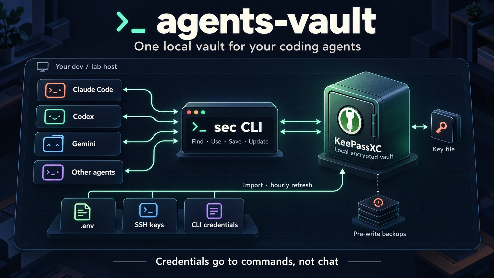

# agents-vault



A local, on-prem credential store for AI coding agents (Claude Code, Codex, Gemini/Antigravity, Kimi, ...)
on an agent server. Agents look up and use passwords, tokens, SSH keys, certificates and whole `.env` files
themselves instead of asking a human, and save new credentials they create.

## What problem does agents-vault solve?

Coding agents need credentials to run applications and work with development services. Those
credentials are often scattered across `.env` files, SSH keys, CLI configurations, and projects.

agents-vault gives trusted agents one local place to **find, use, save, and update development
credentials**, reducing repeated requests for secrets and avoiding the need to paste them into chat.
It uses a local KeePassXC database, so there is no additional secrets server to operate.

## How it works

1. **Store:** credentials live in an encrypted KeePassXC database, unlocked automatically with a
   local key file. The database uses standard KDBX 4 and opens in the KeePassXC application.
2. **Import:** a configuration file identifies existing credential sources. The importer copies
   their contents into the vault without moving or deleting the originals.
3. **Find and use:** agents search for entries, inspect metadata, and inject credentials into
   command environments or export attached files. The installer adds instructions to agents'
   global instruction files so they know how to use the vault.
4. **Save:** agents store newly created credentials through standard input.
5. **Update:** an hourly timer refreshes imported entries when their sources change.
   Manually managed entries remain separate.
6. **Recover:** writes create backups first; the latest 200 are retained. Keep an off-host copy
   of both the database and key file for disaster recovery.

**Imported entries follow their source files.** Update the source file to rotate an imported
credential. For manually managed entries, use `sec set` or `sec gen`. Updating the vault alone
does not rotate a credential at its service.

For example, an agent can start a development application with its saved environment:

```bash
sec run @myapp/api-dev -- npm run start:dev
```

`sec run` avoids printing credentials itself; commands it launches must also avoid logging them.
This system is for trusted agents on development and lab hosts, with no per-agent permissions or
read audit log. Anyone with access to both the database and key file can read its contents.
**Never store production credentials here.**

**This repo contains no credentials, and must never contain any.** See [Repo hygiene](#repo-hygiene).

## Contents

| path | what |
|---|---|
| `install.sh` | installs/upgrades everything on a host (idempotent, never replaces an existing vault) |
| `bin/sec` | the CLI agents use |
| `bin/sec-mcp`, `lib/mcp_server.py` | optional local MCP discovery interface |
| `lib/common.py` | shared dotenv parser, command environment, and backup retention |
| `lib/import.py` | the importer behind `sec import` (stdlib Python >= 3.11 + keepassxc-cli) |
| `examples/sources.example.toml` | every source type, documented |
| `templates/agent-rule.md` | the section added to CLAUDE.md / AGENTS.md / GEMINI.md |
| `templates/vault-README.md` | guide placed at `~/.agents-vault/README.md` for agents |
| `systemd/`, `lib/launchd.py` | hourly imports through systemd on Linux or launchd on macOS |
| `tests/smoke.sh` | end-to-end test on a throwaway vault |
| `tools/check-no-secrets.sh` | fails if any vault value appears in this repo (pre-commit hook) |

## Design and its trade-offs

- **On-prem, file-based, no server.** Nothing leaves the host and there is no service to crash, unseal or
  keep alive. Labs lose power and VMs; when the store is a file, agents keep working as long as the disk does.
  A vault server (Vault/OpenBao/Vaultwarden) or a cloud manager was rejected for this reason.
- **Key file, no password.** That is what lets agents open it unattended. Consequence: anyone who can read
  `agents.keyx` can read every secret in the vault. It is encrypted at rest, and access is all-or-nothing.
  That is acceptable only because the vault holds **dev/lab credentials, never prod**. Keep prod out.
- **No per-agent permissions and no read audit log.** If you need those, put a hosted secrets manager
  behind the same `sec` interface.
- **Secrets stay out of transcripts.** Agent conversations are logged and sent to model providers, so the
  rules tell agents to use `sec run` (values go into the child process's environment) rather than printing them.
- **The vault is an index, not the only copy.** The importer copies; it never moves or deletes source files.

## Install on Linux or macOS

Requirements: Python >= 3.11 and `keepassxc-cli` >= 2.7. Linux uses a systemd user timer;
macOS uses a per-user launchd agent. The CLI works without a scheduler (`--no-timer`).
Linux apt systems can install KeePassXC through `sudo`; macOS can install missing dependencies
through [Homebrew](https://brew.sh/). Linux was tested locally on Ubuntu 24.04 with KeePassXC 2.7.6;
the repository's CI runs CLI and MCP tests on both Linux and macOS.

### Let a coding agent handle installation

**Copy this one prompt into your coding agent.** No checkout, separate setup commands, or edits
to the prompt are required. Run the agent on the target Linux or macOS host as the user who will
own the vault, with terminal and network access. The manual instructions below are an optional
reference, not extra steps you need to perform.

```text
Install or upgrade agents-vault on this host. Perform the work end to end and
validate the installed tools; do not just give me commands or a plan.

Repository: https://github.com/karmahacker/agents-vault.git
Branch: main

1. Obtain the code. Reuse a checkout of this repository if available; otherwise
   clone the URL above into a suitable user-owned directory and enter it.
   Fetch current main. Preserve local edits and commits; use a separate checkout
   if updating the existing one would overwrite work. Read the repository README
   and applicable agent instructions before running installation commands.

2. Check prerequisites. Detect Linux or macOS and ensure Git, Python >= 3.11,
   and keepassxc-cli >= 2.7 are available. Install missing dependencies using
   the documented OS procedure. On macOS, install Homebrew from its official
   source if needed. Use available privileges; if authentication or an OS
   approval is required, request it through the terminal/private approval UI,
   never by asking me to paste a password into chat. Do not bypass access controls.

3. Preserve existing data. Inspect whether this is a new installation or an
   upgrade. Keep the existing vault, key file, sources configuration, installation
   preferences, and unrelated agent rules. If a database or key exists without
   its counterpart, stop vault setup and report what needs restoring. Never
   replace it with a fresh vault. Never print credentials or put them in command
   arguments, logs, chat, or the repository.

4. Configure sources without blocking installation. On upgrades retain the
   existing sources. On a new installation, import only dev/lab sources I have
   explicitly identified in this conversation. If none are identified, create
   an empty valid ~/.config/agents-vault/sources.toml with mode 0600, inside a
   mode 0700 directory, and finish installing an empty usable vault. Do not ask
   me to select projects just to complete installation, scan the whole host for
   secrets, or copy the example's placeholder sources into live configuration.
   Use the example only as a syntax reference. Exclude production/staging
   credentials and coding-agent login files. Store no literal secrets in TOML.

5. Install and configure. Run ./install.sh with flags appropriate to the existing
   installation. Keep the CLI as the default; preserve an existing MCP setup,
   and use --with-mcp only if I requested MCP or it is already installed. For
   requested MCP, configure the current client's local stdio server if its
   documented configuration is available, preserving unrelated settings.
   Set up hourly imports using the systemd user timer and linger on Linux,
   or the per-user LaunchAgent on macOS. Mac imports pause while logged out or
   asleep. Ensure sec is accessible to this agent; use its absolute installed
   path if PATH does not include it. Install the guide and supported agent rules.

6. Validate. Run tests/smoke.sh and python3 tests/regression.py against throwaway
   data. Verify the installed command's location, run sec help and sec ls without
   displaying values, then run sec import --dry-run. Expect 0 would change after
   importing configured sources; investigate changes and skipped-source warnings
   rather than relying only on exit codes. An intentionally empty sources file
   is valid: report that no credentials have been imported yet. Verify vault
   directory mode 0700, database/key modes 0600, and the installed guide and agent
   rules. Check the enabled/active systemd timer and linger on Linux, or the loaded
   LaunchAgent on macOS. If MCP is installed, run its documented integration test
   using the MCP venv. Do not rotate credentials or contact services to test them.

Complete all steps that the host permits. Ask for input only for a real blocker
such as required privileges, restoring an incomplete vault, or resolving an
ambiguous existing setup. If a scheduler, client reload, or another step cannot
be completed, report it precisely; do not claim it passed.

Finish with the installed branch and commit, command location, checks passed,
scheduler/MCP status, imported or skipped sources, and any genuinely remaining
action. Do not leave routine installation or validation commands for me to run.
```

### Manual installation

```bash
git clone --branch main https://github.com/karmahacker/agents-vault.git agents-vault
cd agents-vault

# 1. Describe what to import (paths only, never values). Start from the example:
mkdir -p ~/.config/agents-vault
cp examples/sources.example.toml ~/.config/agents-vault/sources.toml
$EDITOR ~/.config/agents-vault/sources.toml     # rebuilding a host? restore its copy kept in the vault

# 2. Install: deps, sec, importer, vault + key file, hourly timer, agent rules, first import.
./install.sh

# 3. Linux only: let the timer run while nobody is logged in.
# On macOS, skip this step; the LaunchAgent runs in your logged-in session.
if [ "$(uname -s)" = Linux ]; then sudo loginctl enable-linger "$USER"; fi

# 4. Verify.
tests/smoke.sh                 # throwaway vault, touches nothing real
sec ls                         # what got imported
sec import --dry-run           # should say "0 would change"
```

Then check that a fresh agent uses it without help, e.g.
`claude -p "Find our Cloudflare DNS token and check it works with a read-only API call; don't show it."`.

Installer flags: `--sources FILE` (install FILE as sources.toml if none exists), `--no-system-link`,
`--no-timer`, `--no-rules`, `--no-import`, `--with-mcp`. Re-running `./install.sh` after `git pull` upgrades `sec` and the
importer in place and refreshes the agent rules and installed guide. It preserves the existing database,
key file and sources configuration; the default import can update imported entries.

### macOS setup and scheduled imports

Install [Homebrew](https://brew.sh/) if needed, then:

```bash
brew install python
brew install --cask keepassxc
./install.sh
# Optional MCP interface:
# ./install.sh --with-mcp --no-import
```

Homebrew's [KeePassXC cask](https://formulae.brew.sh/cask/keepassxc) includes `keepassxc-cli`.
The installer also recognizes the CLI in `/Applications/KeePassXC.app/Contents/MacOS` for a
manual app installation. It checks both Apple Silicon (`/opt/homebrew`) and Intel (`/usr/local`)
Homebrew paths. No GNU `flock`, coreutils, or replacement Bash is required.

On macOS, installation defaults to user-local commands in `~/.local/bin`, without a system
symlink or `sudo`. Add that directory to your shell's PATH, or invoke `~/.local/bin/sec` directly.
The installer saves the Python and KeePassXC directories in a private `runtime.sh` alongside
the installed scripts so GUI-launched agents can find them. Rerun installation if those
applications move. MCP clients use `/Users/your-user/.local/bin/sec-mcp` as their command.

Hourly imports use `~/Library/LaunchAgents/local.agents-vault.import.plist`, with absolute
program paths and the selected vault and sources paths. The installer loads it in your GUI
session when available; otherwise it is installed for the next graphical login. Per-user
[LaunchAgents run while the user is logged in](https://developer.apple.com/library/archive/documentation/MacOSX/Conceptual/BPSystemStartup/Chapters/CreatingLaunchdJobs.html).
This setup does not provide Linux-style linger: imports pause while logged out or asleep.
Run `sec import` after waking if you need an immediate refresh.

```bash
launchctl print "gui/$(id -u)/local.agents-vault.import"
# Trigger an import now through launchd:
launchctl kickstart "gui/$(id -u)/local.agents-vault.import"
```

Import output is stored in `~/.agents-vault/import.log` and `import-error.log` (or the custom
vault directory). These contain names and status messages; do not paste logs without reviewing
them. Logs are not rotated automatically. `--no-timer` skips scheduler setup on either OS;
it does not disable a schedule installed previously.

### Updating an installed version

From your existing checkout, pull the branch you want to install and rerun the installer:

```bash
cd /path/to/agents-vault
git switch main
git pull --ff-only
./install.sh
```

The repository currently uses `main`. If your team adds a `dev` branch and you want its changes,
use `git switch dev` instead. Commit or stash local edits before switching branches.
Pulling code alone does not update the installed copy.

The installer updates `~/.local/bin/sec`, the Python files in `~/.local/share/agents-vault`,
agent rules, the installed guide, and (when enabled) the systemd units or macOS LaunchAgent. A differing installed guide
is saved as `~/.agents-vault/README.md.previous.*` before replacement, preserving local notes.
The existing vault, key, and sources configuration are retained. Imported entries refresh by default;
to update software without importing, use `./install.sh --no-import`. Reuse flags such as
`--no-timer`, `--no-rules`, or `--no-system-link` if they were part of your original setup.

Verify the checkout with `tests/smoke.sh` and `python3 tests/regression.py`, then check the installed
command with `sec help` and `sec import --dry-run`. Tests use temporary data, not the real vault.

### Finding what to import on a host

List credentials without printing values, then turn the results into `[[...]]` blocks in sources.toml:

```bash
# dotenv files (skip node_modules/.git), names only
find ~ -xdev \( -name node_modules -o -name .git -o -name .cache \) -prune -o \
  -type f \( -name '.env' -o -name '.env.*' -o -name '*.env' \) -print | grep -vE '\.(example|sample|template)$'
for f in <file>; do grep -oE '^\s*(export\s+)?[A-Za-z_][A-Za-z0-9_]*=' "$f"; done   # variable names only
ls ~/.ssh ~/.aws ~/.kube ~/.docker ~/.cloudflared ~/.config/{gh,doctl,rclone} 2>/dev/null
kubectl get secrets -A | grep -iE 'token|cloudflare|api'        # cluster-held tokens
```

Skip prod/stage env files, git worktree copies of the same `.env`, and agent-tool logins (their auth files
belong to the tools themselves).

## Using it (for agents and humans)

These are the core `sec` CLI commands. The optional [MCP interface](#optional-mcp-interface)
provides discovery tools alongside them. Run `sec help` for full syntax and options.

| Feature | Command | What it does |
|---|---|---|
| Browse | `sec ls [group]` | Lists entry paths without values |
| Search | `sec find <term>` | Finds matching entries |
| Inspect | `sec info <entry>` | Shows metadata, field names, and attachments; protected values stay hidden |
| Read a value | `sec get <entry> [field]` | Prints a value; use only when needed to write a file or configuration |
| Run with a credential | `sec run VAR=entry[:field] -- cmd` | Supplies a credential through the command's environment |
| Run with an environment file | `sec run @entry -- cmd` | Loads variables from an attached `.env` file |
| Save or update | `sec set <entry>` | Creates or updates a password, reading the value from standard input |
| Edit metadata | `sec meta <entry> ...` | Updates username, URL, or notes without changing the password |
| Generate a password | `sec gen <entry> [-L length]` | Generates and stores a password |
| Organize | `sec mv <entry> <group>` | Moves an entry |
| Remove | `sec rm <entry>` | Moves an entry to the Recycle Bin |
| List files | `sec file ls <entry>` | Lists attachments |
| Attach a file | `sec file put <entry> <name> <path>` | Adds or replaces an attachment |
| Export a file | `sec file get <entry> <name> <out>` | Exports a key, certificate, or other attachment |
| Refresh imports | `sec import` | Updates entries from configured sources |
| Preview changes | `sec import --dry-run` | Reports pending changes without updating entries |
| Find backups | `sec backups` | Lists automatic backups |
| Command reference | `sec help` | Shows syntax and options |

Examples:

```bash
sec run @myapp/api-dev -- npm run start:dev
sec run CLOUDFLARE_API_TOKEN=cloudflare/dns-edit -- ./dns.sh
sec file get myapp/api-dev .env ~/Dev/new-worktree/.env
printf %s "$NEW_TOKEN" | sec set openai/dev-key --url https://platform.openai.com --notes "used by X"
```

Entry conventions: `<project>/<service>-<env>` for env bundles (secret vars as fields plus the whole file as
attachment `.env`); `ssh/<host>` for keys (URL `ssh://user@host`); API tokens also carry the env-var name
they are used under as a field (`CLOUDFLARE_API_TOKEN`, `GH_TOKEN`, `AWS_ACCESS_KEY_ID`, ...).

### Supported dotenv syntax

Import and `sec run @entry` use the same parser: one `NAME=value` assignment per line, optional
`export`, surrounding whitespace trimmed, and matching single or double quotes removed. Values
inside quotes retain their whitespace. Duplicate names use the last assignment; blank lines, comments,
and other non-assignment lines are ignored. Inline `#` characters are literal. Variable expansion,
escape decoding, and multiline values are not supported; the file is never executed as shell code.

## Optional MCP interface

The CLI works without MCP. Enable MCP when you want your agent client to discover structured
vault tools automatically. This optional interface uses the [official MCP Python SDK](https://py.sdk.modelcontextprotocol.io/)
and runs locally over **stdio**, launched by your client; it opens no HTTP port.

### Install and connect

```bash
# From the repository checkout; keeps the existing vault and skips importing credentials.
./install.sh --with-mcp --no-import
```

Python venv support is required (`sudo apt-get install python3-venv` on apt systems if missing; Homebrew Python includes it).
The option installs the pinned SDK and its dependencies into
`~/.local/share/agents-vault/mcp-venv` and adds `~/.local/bin/sec-mcp`.
The default installation adds no MCP dependencies. Rerun with `--with-mcp` when upgrading MCP
so its dependencies are refreshed too; normal upgrades refresh an existing MCP server's code.

In your agent client's MCP settings, add a **local stdio server** whose command is the absolute
path to `~/.local/bin/sec-mcp`, with no arguments. For clients using `mcpServers` JSON:

```json
{
  "mcpServers": {
    "agents-vault": {
      "command": "/home/your-user/.local/bin/sec-mcp"
    }
  }
}
```

Replace the example path with your actual home directory; `~` may not expand in client settings.
Use the client's equivalent configuration format if it does not accept this JSON. The client must
launch the server as the vault-owning OS user on the same host. If using a custom vault location,
set `SEC_VAULT_DIR` in the server's environment to its absolute path. Do not put credentials in
client configuration. Installation does not edit client settings automatically.

Restart or reconnect your client, check that the three tools below appear, then call `list_entries`.
A direct terminal launch waits for MCP protocol input; it is not an interactive CLI.
To test the protocol using a throwaway vault from the checkout:

```bash
~/.local/share/agents-vault/mcp-venv/bin/python tests/mcp_integration.py
```

### Available tools

| MCP tool | Arguments | Returns |
|---|---|---|
| `list_entries` | optional `group` | Entry paths, optionally restricted to a group and its descendants |
| `find_entries` | `query` | Paths matching entry, field, or attachment names, case-insensitively |
| `describe_entry` | `entry` | Entry path, field names, and attachment names |

These tools are read-only. They do not return passwords, usernames, URLs, notes, custom-field
values, or attachment contents. Search does not inspect values or notes. Names themselves are
visible to the model: keep secrets out of entry, group, field, and attachment names.

Use `sec run` for credential injection, `sec set` through stdin for saving, and `sec file` for
attachments. There is no MCP password-return, credential-input, arbitrary-command, or file-export
tool. Clients without terminal access can discover credentials but cannot use or update them
through this interface alone. MCP does not replace the hourly importer or change its behavior.

### Pros and cons

**Advantages:** clients discover named tools and argument schemas without memorizing CLI syntax.
The same discovery interface works across compatible MCP clients, with structured results that
are easier for agents to interpret. Credential values stay out of these tool responses.

**Trade-offs:** MCP adds a Python environment, SDK dependencies, client configuration, and another
process to maintain. Tool availability and invocation depend on the client. Names and tool calls
may be logged or sent to the model provider. The server process can decrypt the vault locally;
its limited tool surface is not an OS security boundary or per-agent access control. Each request
reads a fresh vault snapshot, so very large vaults may make discovery slower.

For terminal-capable coding agents, **start with the CLI**. Add MCP for discovery convenience,
not as a stronger permission system. A generic MCP tool returning a password would expose it to
model context; this implementation intentionally keeps credential operations in the CLI.

To disable MCP, remove its client configuration. To uninstall the optional components, stop the
client's server process and remove `~/.local/bin/sec-mcp`,
`~/.local/share/agents-vault/mcp_server.py`, and `~/.local/share/agents-vault/mcp-venv`.
The CLI, vault, and import timer continue to work.

## The importer

`sec import` reads `~/.config/agents-vault/sources.toml` (override with `AGENTS_VAULT_SOURCES` or `--config`).
Source types, all documented in `examples/sources.example.toml`:

| type | imports |
|---|---|
| `env` | a dotenv file. Secret-looking vars become protected fields, the whole file is attachment `.env`. Secret = name matches PASSWORD/SECRET/TOKEN/`*_KEY`/... (not TTL/INTERVAL/PUBLIC/`*_URL`...), or the value is a URL with `user:pass@`. Force more with `secret_vars = [...]` |
| `ssh` | private key + `.pub` as attachments, user/host as URL |
| `files` | files or whole directories as attachments; optional `password_file` |
| `value` | one value from a file, whole content or first `pattern` regex group; optional extra `field` |
| `aws_profile` | static keys of a profile in `~/.aws/credentials` |
| `gh_token` | the token `gh` is logged in with |
| `docker_auths` | each registry login in `~/.docker/config.json` |
| `cloudflared_tunnels` | each locally-managed tunnel's YAML + credentials JSON |
| `k8s_secret` | one key of a Kubernetes secret via `kubectl` |

How it behaves:
- Prints entry and field names only, never values.
- Builds KeePass XML, loads it with `keepassxc-cli import`, then `keepassxc-cli merge`s it into the vault.
  Existing UUIDs are reused, so entries update in place and the previous version goes to entry history.
- Skips unchanged entries, so the hourly run is a no-op unless a source changed.
- Never touches entries not listed in sources.toml, so hand-added and agent-added entries are safe. The
  reverse also holds: **don't hand-edit imported entries**, because the next import overwrites them. Change the source file.
- Takes the same lock as `sec` writes, and backs the vault up before writing.
- Adding a source type is one `src_<type>(vault, table)` function plus a `SOURCES` entry in `lib/import.py`.

## Operations

- **Backups.** Every `sec` write and every import that changes something first copies the vault to
  `~/.agents-vault/backups/`. Both write paths keep the latest 200 backup files.
  Restore by copying a backup over `agents.kdbx`. All of these sit on the same disk as the vault, so also keep an off-host copy of `agents.kdbx` **and** `agents.keyx` (e.g.
  `scp` to a workstation). Without the key file the vault cannot be opened.
- **Opening in the KeePassXC app.** File > Open `agents.kdbx`, leave the password empty, choose
  `agents.keyx` as the key file.
- **Merging with a personal KeePass database.** Use KeePassXC Database > Merge from database, or
  `keepassxc-cli merge`. Both files stay plain KDBX.
- **Moving to another server.** Copy `agents.kdbx` and `agents.keyx` into `~/.agents-vault/` on the new
  host *before* running `./install.sh`. The installer keeps an existing vault.
- **Rotating the key file.** Run `keepassxc-cli db-edit --set-key-file new.keyx --no-password -k agents.keyx agents.kdbx`,
  then replace `agents.keyx` and update the off-host copy.
- **Uninstall.** On Linux, run `systemctl --user disable --now agents-vault-import.timer`.
  On macOS, run `launchctl bootout "gui/$(id -u)/local.agents-vault.import"` in your logged-in
  session and remove `~/Library/LaunchAgents/local.agents-vault.import.plist`. Then remove `~/.local/bin/sec`,
  `/usr/local/bin/sec`, `~/.local/bin/sec-mcp` (if installed), `~/.local/share/agents-vault`, and the "Secrets (agents vault)" sections. The vault
  stays in `~/.agents-vault` until you delete it.

## Gotchas found while building it

- **Don't write the vault with pykeepass.** A pykeepass 4.x save of a KeePassXC-created KDBX 4 file left
  it unreadable by KeePassXC 2.7.6 ("Header doesn't match hash", plus one "found unused key" line per
  attachment). That is why the importer goes through XML + `keepassxc-cli import/merge`.
- **keepassxc-cli 2.7 flag names.** `show --show-attachments`, not `--attachments`. `show -a <field>` reads
  custom fields too. `add`/`edit` can't set custom fields, which is why `sec set` only manages the standard
  fields and the importer uses XML.
- **PATH in non-login shells.** Agents often run non-login shells whose PATH lacks `~/.local/bin`, so the
  installer symlinks `/usr/local/bin/sec`. The same applies to tools sources rely on: give `k8s_secret`
  an explicit `kubectl = "~/.local/bin/kubectl"` when needed.
- **`gh` prefers `GITHUB_TOKEN`/`GH_TOKEN` from the environment** over its own login. Keep that in mind
  when testing tokens with `sec run`.
- **Prisma-style DB URLs** (`?schema=public`) are rejected by `psql`. That's a client problem, not a bad
  credential.

## Repo hygiene

- `.gitignore` blocks `*.kdbx`, `*.keyx`, `*.pem`, `*.key`, `.env*`, `sources.toml` (except `examples/`).
- **Nothing from a real environment goes in this repo**: no credentials, no real sources.toml, hostnames,
  IP addresses, account/zone/tunnel ids, user or project names. Examples use `example.com`, `myapp` and the
  documentation IP ranges (192.0.2.0/24, 198.51.100.0/24, 203.0.113.0/24).
- A host's real sources.toml stays on that host, with a backup copy inside its own vault:
  `sec file put agents-vault/sources-$(hostname) sources.toml ~/.config/agents-vault/sources.toml`.
- Sources files contain paths and names only; a literal password has no supported syntax, on purpose.
  Credentials with no file on the host go in by hand with `sec set`.
- Before every commit, run `tools/check-no-secrets.sh`, or install it once as a hook:
  `ln -s ../../tools/check-no-secrets.sh .git/hooks/pre-commit`. It scans staged blobs as well as tracked
  and untracked, non-ignored working files, and fails if either version contains
  - any value stored in the local vault (passwords, fields, key/cert lines);
  - an IPv4 address outside loopback, private and documentation ranges, a 12-digit number (AWS account id),
    a 32-hex id or a UUID, unless listed in `tools/allowlist.txt`;
  - any term from your private denylist `~/.config/agents-vault/denylist.txt` (one per line: your domains,
    hostnames, user, project and account names). That file is never committed.
